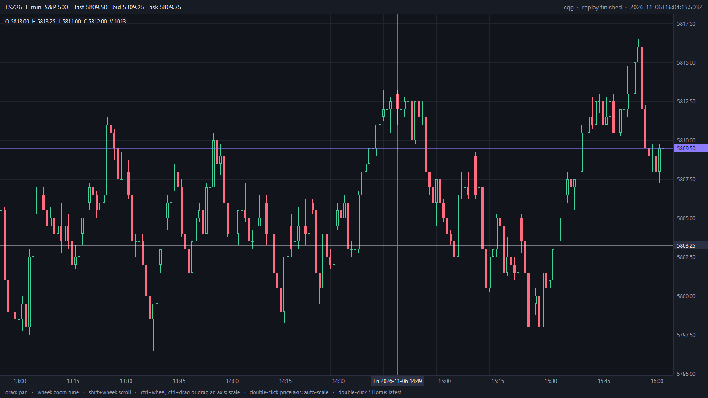

<p align="center">
  
</p>

<h1 align="center">Lines</h1>

<p align="center">A native, fast futures charting and DOM platform for discretionary and prop-firm traders.</p>

[](https://github.com/anaremore/lines/actions/workflows/ci.yml)



<sub>Synthetic mock data, rendered with Lines' screenshot mode.</sub>

## Status: pre-alpha

Lines is early. Nothing here is ready for trading.

**Works today**

- Data feeds: an in-process mock, the Coinbase public feed (BTC/USD, ETH/USD, free and 24/7), and replay of recorded sessions. Every feed can be recorded and replayed deterministically.
- Candlestick chart with pan, zoom and axis scaling, a crosshair with an OHLCV readout, and device-pixel-sharp drawing.
- Read-only DOM: a tick-indexed price ladder with depth bars, exact price grouping, traded volume per price, and auto-centering that never moves while the pointer is over it. Time & sales with the aggressor side shown by color and a marker, and large prints highlighted.
- Independent panes (chart, DOM, time & sales) that share one feed per contract. The default window puts the chart beside the DOM, with time & sales under it.
- Exact prices and quantities (integer units, never floating point), and a futures product/contract model with front-month resolution.
- Dark and light themes, a colorblind-safe palette, and hollow vs filled candles so direction never depends on color alone.

**Not yet**

- No live trading and no order entry. Public builds cannot route orders.
- No custom layouts, tabs or extra windows yet (next: workspaces).
- No live futures data in public builds. Vendor connections are kept out of the public code (decision 0014).

See [ROADMAP.md](ROADMAP.md) for what comes next.

## Build and run

### Windows

You need [Rust](https://rustup.rs) and the Visual Studio C++ build tools (MSVC and the Windows SDK). The pinned Rust toolchain installs itself on the first build.

```sh
git clone https://github.com/anaremore/lines.git
cd lines
git submodule update --init      # protocol definitions the build needs
cargo run --release -p lines-app -- --source mock
```

If your shell can't find `cargo`, add it to `PATH` first (PowerShell):

```powershell
$env:PATH = "$env:USERPROFILE\.cargo\bin;$env:PATH"
```

Other sources and options:

```sh
cargo run --release -p lines-app -- --source coinbase                        # live BTC/USD
cargo run --release -p lines-app -- --source mock --record recordings/x.lfr  # record a session
cargo run --release -p lines-app -- --source replay --replay recordings/x.lfr --speed 10
cargo run --release -p lines-app -- --theme light --palette cb               # colorblind-safe colors
```

The first build takes several minutes. Later builds are quick.

### macOS and Linux

CI-tested; see the workflow in [`.github/workflows/`](.github/workflows/). Tested by hand on an Apple-silicon Mac (macOS 27, Retina).

macOS: install Xcode, or build with `--features runtime-shaders`. By default GPUI compiles its Metal shaders at build time with `xcrun metal`, which only full Xcode includes (not the command-line tools). `runtime-shaders` compiles them at startup instead, which makes startup slower:

```sh
cargo run --release -p lines-app --features runtime-shaders -- --source mock
```

## How it fits together

```
 feed thread (Tokio)                        UI thread (GPUI)
 ┌───────────────────────┐   events   ┌────────────┐  try_lock,   ┌────────────┐
 │ provider session      │──────────▶ │ ChartStore │◀─ once per ──│ chart view │
 │ mock · Coinbase ·     │  (exact    │ bars, book │   frame      │ paint: no  │
 │ replay                │   units)   └────────────┘              │ allocation │
 └───────────────────────┘                                         └─────┬──────┘
                                                                        │ order intents
 OMS (planned, its own thread; decision 0012) ◀─────────────────────────┘
```

- The feed never blocks the UI: it decodes off the UI thread, and the chart samples the latest state once per frame.
- Orders will bypass the frame loop and go straight to an OMS that keeps running even if the UI stalls.

Architecture decisions are recorded in [`docs/decisions/`](docs/decisions/). UI principles are in [`docs/design.md`](docs/design.md).

## Troubleshooting

Export diagnostics from the command palette (Ctrl+Shift+P, "Export diagnostics") and attach the zip; it stays on your computer until you share it, with credentials and account IDs removed.

## License

[FSL-1.1-ALv2](LICENSE.md): you can read, use and modify Lines for any purpose except building a competing commercial product, and each release becomes Apache 2.0 two years after it is published.
