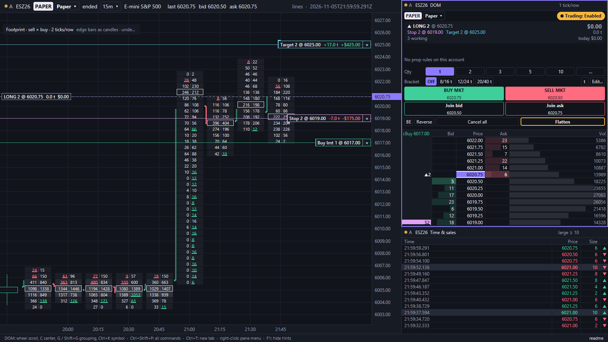
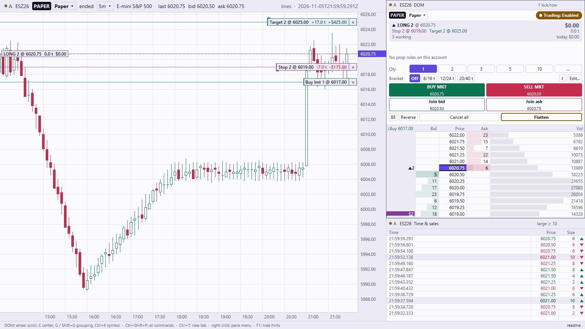
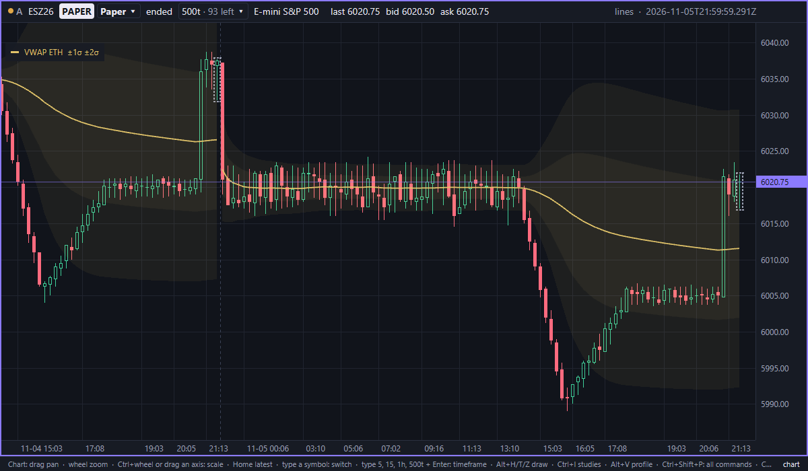

<p align="center">
  
</p>

<h1 align="center">Lines</h1>

<p align="center">A native, fast futures charting, DOM and paper-trading terminal for discretionary and prop-firm traders.</p>

[](https://github.com/anaremore/lines/actions/workflows/ci.yml)



<sub>All screenshots use synthetic data, rendered with Lines' screenshot mode.</sub>

> [!IMPORTANT]
> **Pre-alpha. Paper trading only.** Lines has no live order routing: every order goes to a simulated paper account. Public builds read the mock futures feed, Coinbase and Kraken public data, Databento (CME futures, with your own Databento account), and replays. Official builds add vendor connectors.

## What works today

**Trading (paper)**
- **DOM:** a tick-indexed ladder with depth, volume at price and a price trail; click, drag and hotkey orders; brackets.
- **Trade panel:** the position card (size, average, open P&L, stop and target, day P&L), quantity and bracket lists, large Buy and Sell, Join bid / Join ask, and BE, Reverse, Cancel all and Flatten always in reach.
- **One-step Reverse** (Ctrl+Alt+R): cancels, closes reduce-only, then opens the other side as its own order.
- **Chart trading:** working orders as lines you drag or cancel; stop and target handles on the position line.
- **Positions pane** (Ctrl+Shift+J): every open position on every account, with Flatten per row and Flatten all.
- **Reset paper account** from the palette, the account menu or Settings: it flattens first and asks for a second press.
- **Options on SPY:** an option chain, and an option chart where Entry, Stop and Target are lines on the underlying's price, held as triggers by the trading core ([decision 0029](docs/decisions/0029-option-chart-and-underlying-triggers.md)).
- **Risk:** your own guardrails (daily loss, losing-streak cooldown, max trades, max position, no entries before the close, economic-calendar blackouts) and prop-firm rule presets (trailing drawdown, daily loss, contract cap).
- **Journal:** every round trip with exact P&L and fees, MAE/MFE, tags, notes, stats and CSV export.

**Charts**
- Minute to weekly candles, plus tick (`500t`), volume (`500v`), range (`10r`) and seconds (`30s`) bars.
- Studies: footprint, volume profile, VWAP with bands, cumulative delta, and Volume in a lower pane or as an overlay.
- External levels: a plug-in source of price levels drawn on the chart, recorded and replayed with the data.
- Drawings: lines, rays, trend lines, zones and notes, each with its own style.
- **Ruler:** Shift+drag measures ticks, points, P&L, bars and time with no tool to pick; move or resize it, and choose which parts show.

**Interface**
- Right-click menus on panes, tabs, orders and drawings.
- UI zoom from 80 to 150 % (Ctrl+= / Ctrl+− / Ctrl+0).
- Floating pop-up panels: palette, symbol picker, studies, style editor and order list.
- Display time zone: exchange (ET) by default, your system's, or any zone.
- Dark and light themes, a colorblind-safe palette, and direction never shown by color alone.
- Workspaces: grids, tabs, pop-out windows and link groups, saved and restored.

**Data**
- Coinbase and Kraken public feeds (spot and perpetuals), a simulated ES futures feed, and deterministic replay.
- Databento CME futures (live top of book and trades, history import) with your own Databento account and API key: see `crates/lines-databento/README.md`. Without a key it stays off and makes no requests.
- **Record / Stop recording** from the app: live feeds and levels go to the data folder, with REC in the footer.
- A local market-data store for live feeds, so charts and order flow open at once on restart.

**Updates**
- In-app updates on Windows: Lines downloads a new release, checks its SHA-256 and signature, and asks before it restarts. A restart waits while a position, working order or armed trigger is open, and the previous version is kept for rollback. v0.3.12 is the last version you install by hand.

Prices and money are exact integers, never floating point.

| | |
|---|---|
|  |  |
| Light theme, Volume study and Positions pane | Tick chart with VWAP bands, levels and the ruler |

## Install

Download your platform's archive from the [latest release](https://github.com/anaremore/lines/releases): a zip for Windows x64 and macOS (Apple silicon), a tar.gz for Linux x64. Extract it and run `lines.exe` (Windows), `Lines.app` (macOS) or `lines` (Linux). SHA-256 checksums are attached. Builds aren't code-signed, so Windows and macOS may warn on first launch. Windows updates itself from then on; on macOS and Linux, download each new release.

## Quick start

```sh
lines --source mock                           # simulated ES futures, any hour; paper trading works
lines --source coinbase --instrument BTC/USD  # live public crypto data, 24/7
lines --source kraken --instrument BTC/USD.KR
lines --source replay --replay session.lfr --speed 10
lines --help                                  # every option
```

To trade on paper, turn on the Trading switch in the DOM's trade panel (or Ctrl+Shift+Space), then click the bid column to buy and the ask column to sell. Shift+click places a stop.

## Keyboard basics

"Ctrl" is Cmd on macOS. The palette lists every command with its key.

| Key | Action |
|---|---|
| Ctrl+Shift+P | Command palette |
| Ctrl+, | Settings |
| Ctrl+K, or type a letter on a chart | Symbol picker |
| `5` / `1h` / `500t` / `500v` / `10r` / `30s` + Enter | Change the chart's timeframe |
| Ctrl+I | Studies |
| Shift+drag on a chart | Ruler |
| Alt+H / Alt+T / Alt+Z / Alt+N | Horizontal line, trend line, zone, note |
| Ctrl+Shift+Space | Trading on or off (DOM) |
| Ctrl+Alt+B / Ctrl+Alt+S | Buy / sell market |
| Ctrl+Alt+R | Reverse |
| Ctrl+Shift+F / Ctrl+Shift+A | Flatten / cancel all orders |
| Ctrl+Shift+J | Positions |
| Ctrl+= / Ctrl+− / Ctrl+0 | UI zoom |
| Ctrl+Shift+D / Ctrl+Shift+E | Hide or show the DOM / time & sales |
| Ctrl+T, Ctrl+PageDown | New tab, next tab |

## Build from source

You need [Rust](https://rustup.rs); the pinned toolchain installs itself on the first build. On Windows, also the Visual Studio C++ build tools (MSVC and the Windows SDK).

```sh
git clone https://github.com/anaremore/lines.git
cd lines
git submodule update --init      # protocol definitions the build needs
cargo run --release -p lines-app -- --source mock
```

macOS: install Xcode, or add `--features runtime-shaders` (Metal shaders compile at startup instead of at build time, which needs full Xcode). The first build takes several minutes.

Architecture and every CLI flag: [`docs/architecture.md`](docs/architecture.md). Decisions: [`docs/decisions/`](docs/decisions/). UI principles: [`docs/design.md`](docs/design.md).

## Roadmap and known gaps

- [ROADMAP.md](ROADMAP.md): what's done and what comes next.
- [docs/known-gaps.md](docs/known-gaps.md): the honest list of current limits.

Troubleshooting: run "Export diagnostics" from the command palette and attach the zip. It stays on your computer until you share it, with credentials and account IDs removed.

## License

[FSL-1.1-ALv2](LICENSE.md): you can read, use and modify Lines for any purpose except building a competing commercial product, and each release becomes Apache 2.0 two years after it is published.
